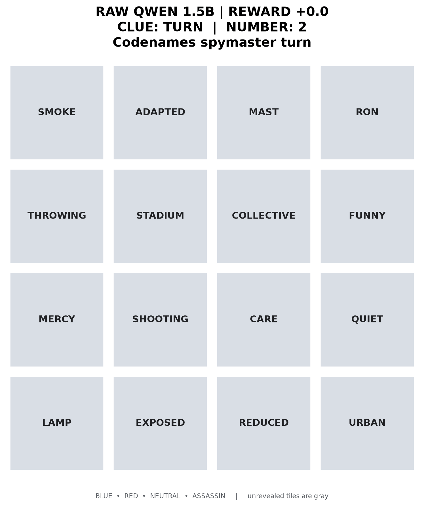
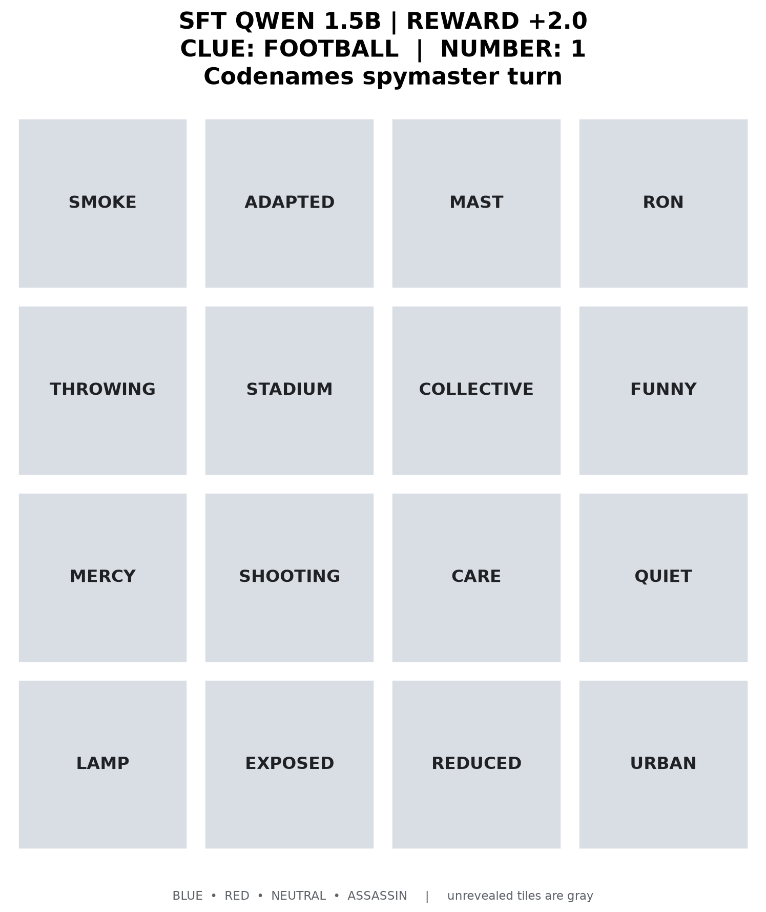
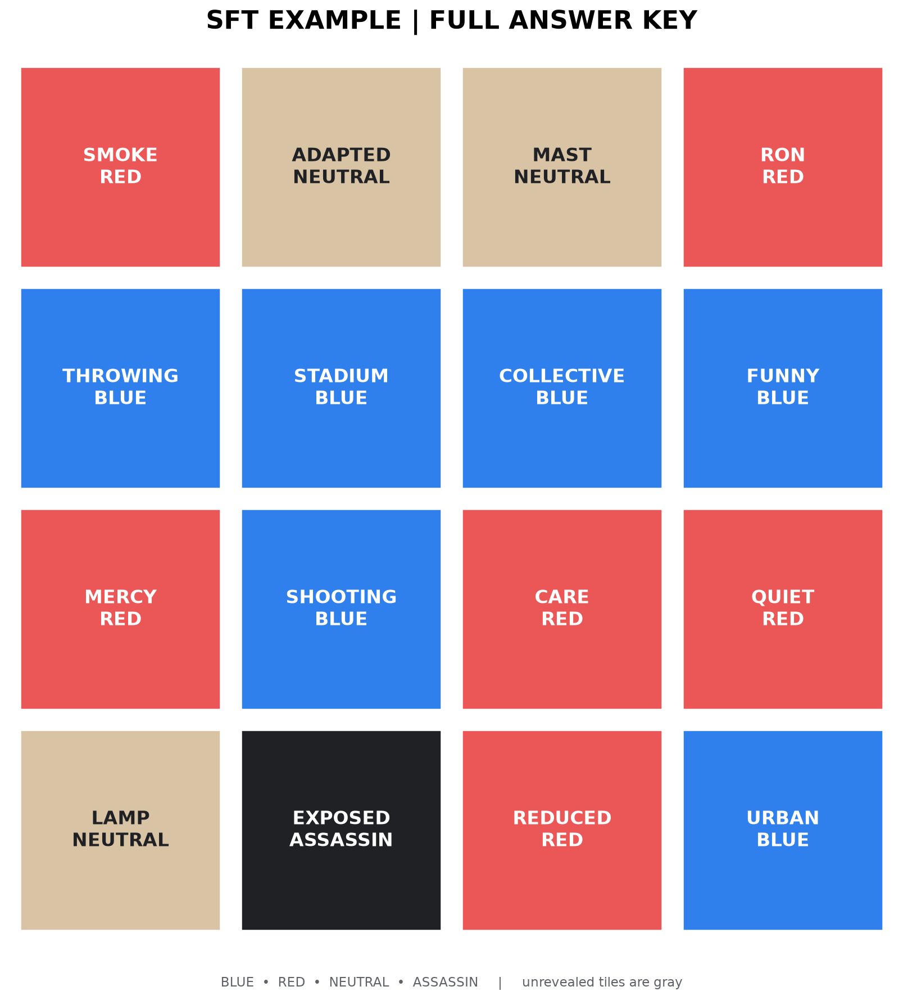
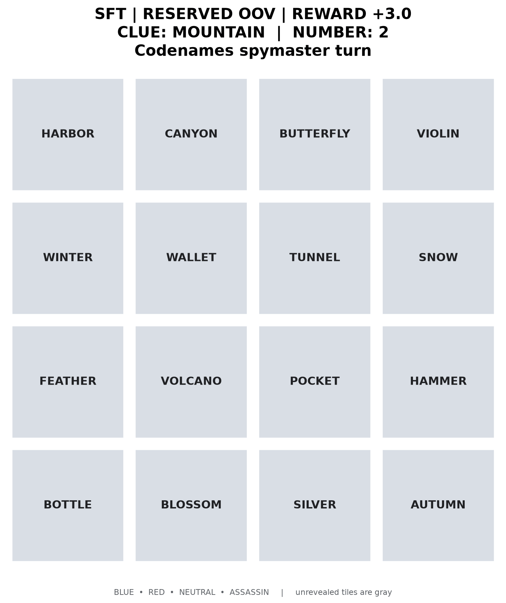
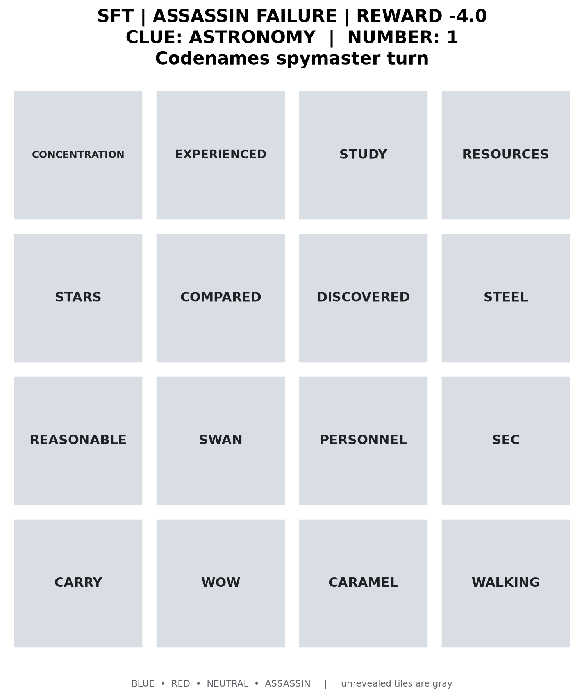

# Codenames Spymaster: SFT, DPO and GRPO

Teaching a small language model to give Codenames clues, then testing whether
preference learning or reinforcement learning improves its play.

The current baseline is **Qwen2.5-1.5B-Instruct with supervised LoRA fine-tuning
(SFT)** on 2,000 synthetic examples. It produces substantially more valid,
useful clues than raw Qwen in our single-turn tests. Subsequent DPO and short
GRPO experiments have **not demonstrated improvement over SFT**.

The spymaster sees remaining board words grouped by their hidden labels and
returns only:

```text
CLUE: football
NUMBER: 1
```

A frozen teammate sees the clue and unguessed words, **never the labels**.
It chooses words using sentence-embedding similarity; the environment scores
the resulting turn. The spymaster always plays BLUE in this implementation.

## See the SFT model play

Same board, same teammate, different clue policy:

| Raw Qwen 1.5B: `TURN 2`, reward 0 | SFT: `FOOTBALL 1`, reward +2 |
| :---: | :---: |
|  |  |

The teammate may make **NUMBER + 1** guesses, so `FOOTBALL 1` can reveal two
BLUE words. Gray tiles are still hidden from the teammate; colored tiles are
revealed. [View this board's full answer key](docs/sft/answer.png).

<details>
<summary>Show the spymaster's answer key for this example</summary>



This key is for inspection only; the teammate never receives these labels.

</details>

| OOV success: `MOUNTAIN 2`, reward +3 | Safety failure: `ASTRONOMY 1`, reward −4 |
| :---: | :---: |
|  |  |

These are **hand-selected illustrations**, including a failure, not a random
sample or evidence of typical performance. All four animations replay actual
saved evaluation rows, without abstention. Their boards, completions, guesses
and source hashes are included in [examples.json](docs/sft/examples.json).

## Evaluation results

Each suite contains **1,000 paired random boards**, with greedy clue generation
and the fixed `all-MiniLM-L6-v2` embedding teammate. These first SFT comparisons
use **no abstention**; rewards are actual game scores, not training losses.

| Suite | Policy | Reward/turn ↑ | Invalid ↓ | BLUE/turn ↑ | Assassin hits ↓ |
| --- | --- | ---: | ---: | ---: | ---: |
| Full boards | Raw Qwen 1.5B | −1.284 | 55.2% | 0.308 | 3.8% |
| | SFT | **0.355** | **5.6%** | **1.199** | 5.8% |
| Partial boards | Raw Qwen 1.5B | −1.315 | 47.5% | 0.284 | 6.6% |
| | SFT | **0.088** | **5.1%** | **1.165** | 9.7% |
| Reserved OOV boards | Raw Qwen 1.5B | −1.522 | 68.8% | 0.203 | 2.8% |
| | SFT | **0.219** | **1.6%** | **1.231** | 9.0% |

Full/partial suites use the 5,476-word SFT board pool, seeds `80000`/`81000`;
partial boards have 0–9 previously revealed tiles. OOV uses 89 reserved words,
seed `82000`, with no revealed tiles. OOV means absent from our training-board
vocabulary, **not** absent from Qwen's pretraining. These suites are not directly
comparable to the [historical 0.5B GRPO results](docs/experiments.md#results).

**Safety remains unresolved.** SFT makes more useful guesses, but also hits more
assassins than the raw base model. Raw Qwen often produces an invalid clue and
never guesses. Assassin percentages above are per evaluated turn, including
invalid turns—not per valid turn or a full-game loss rate.

### A safer fixed teammate

Abstaining before **every** guess with cosine similarity below `0.30` improved
the unchanged SFT policy on a separate, prespecified fresh-board test:

| Metric | No abstention | Cutoff 0.30, mode `all` |
| --- | ---: | ---: |
| Reward/turn | 0.2015 | 0.2916 |
| BLUE/turn | 1.1873 | 1.1280 |
| Assassin hits | 8.47% | 7.07% |
| RED hits | 42.73% | 35.67% |

This test has 1,500 turns: 500 full, 500 partial and 500 reserved OOV boards.
Paired reward gain +0.0901, approximate 95% interval [+0.0562, +0.1241]; 95.0%
of BLUE guesses retained. OOV reward was nearly unchanged. This is a **teammate
change, not a training gain**; cosine similarity is not a calibrated probability.

### What happened after SFT?

Same 1,000 partial development boards (seed `170000`, 5,000-word vocabulary),
same teammate (`0.30`, `all`), same SFT starting adapter and frozen SFT reference:

| Policy | Reward/turn | Invalid | BLUE/turn | Assassin hits |
| --- | ---: | ---: | ---: | ---: |
| SFT baseline | 0.1590 | 6.3% | 1.020 | 7.5% |
| Outcome-based DPO, 38 updates | 0.1553 | 6.5% | 1.006 | 7.5% |
| Same-NUMBER, clue-only DPO, 33 updates | 0.1352 | 6.3% | 1.022 | 8.0% |
| Game-only GRPO, 50 updates | 0.1332 | 6.5% | 1.016 | 7.8% |

Neither DPO variant nor this GRPO pilot demonstrated better gameplay. GRPO's
paired reward change is −0.0258, bootstrap 95% interval [−0.0575, +0.0029].
This does **not** establish that DPO or GRPO cannot work. The seed was reused
for diagnostics, so it is development data, not independent confirmation.

Keep SFT as the standalone baseline. The next diagnostic is to examine sampled
clue quality and NUMBER calibration before spending more compute; that audit is
planned, not completed. See the [experiment guide](docs/experiments.md),
[DPO pair review](data/dpo/review.md),
[clue-only review](data/dpo-clue-only/review.md), and
[GRPO report](docs/grpo-game-only.md). Machine-readable aggregates and source
CSV hashes are in [evaluation-summary.json](docs/evaluation-summary.json).

## Train and evaluate

Python 3.11+; the tested training machine is an **RTX 5070 Laptop GPU with 8 GB
VRAM**. SFT uses Unsloth 4-bit QLoRA, rank 16, batch size 1 and accumulation 8.
Evaluation uses the ordinary Transformers environment. GPU memory needs depend
on sequence length, versions and rollout settings; 8 GB is not a blanket guarantee.

```bash
# Baseline dependencies and tests (uv.lock pins this environment).
uv sync
uv run python -m unittest discover -s tests -v

# Separate acceleration environment; do not mix its stack into .venv.
uv venv .venv-unsloth --python 3.12
uv pip install --python .venv-unsloth/bin/python -r requirements-unsloth.txt

# Validate masks/token lengths, then train response-only SFT.
.venv-unsloth/bin/python train_sft.py --dry-run
.venv-unsloth/bin/python train_sft.py \
  --model-name Qwen/Qwen2.5-1.5B-Instruct \
  --epochs 2 --learning-rate 5e-5 \
  --output-dir outputs/codenames-sft-1p5b
```

The recorded run trained for 450 optimizer updates and exported checkpoint 100,
selected by the lowest held-out **imitation loss**, not the highest game reward.
To resume, repeat the same training command with `--resume`; work after the
latest saved checkpoint is replayed. Use a new output directory for changed
settings. Model weights and local run artifacts are **not included in this repo**.
Retraining may not reproduce the exact saved completions across library versions.
The optional Unsloth requirements are unpinned; the recorded version information
is in the evaluation summary, rather than a promise of an identical install.

The bundled DPO datasets are evidence from the recorded run and pin that exact
SFT adapter's hashes. A newly trained adapter will usually differ: collect and
audit new preference data in a new directory before DPO rather than bypassing
the provenance check.

Reproduce the full-board, no-abstention SFT comparison:

```bash
.venv/bin/python evaluate.py \
  --base-model Qwen/Qwen2.5-1.5B-Instruct \
  --adapter-dir outputs/codenames-sft-1p5b \
  --vocabulary-file data/sft/board_vocabulary.txt \
  --num-boards 1000 --seed 80000 \
  --output-csv results/evaluation-sft-random.csv \
  --transcript-file results/transcripts-sft-random.txt
```

For partial boards, add `--max-revealed 9 --seed 81000` and use new output paths.
For OOV, replace the vocabulary with `data/evaluation_vocabulary_oov.txt`, use
`--seed 82000` and new paths. To evaluate the abstaining teammate, add
`--min-similarity 0.30 --abstention-mode all` and label that as a separate protocol.
Use `--baseline-adapter-dir outputs/codenames-sft-1p5b` when comparing another
adapter against SFT rather than raw Qwen.

Call `.venv/bin/python` and `.venv-unsloth/bin/python` explicitly to select the
environment. With `uv run` inside `.venv-unsloth`, use `--active` or uv may select
the project's `.venv` instead.

### Read the CSV and inspect turns

Rows sharing `board_index` form a comparison. `model=base` means raw Qwen unless
`--baseline-adapter-dir` was supplied, in which case it means that baseline
adapter. `model=trained` is the evaluated adapter. Read `completion` even for
invalid outputs; `clue` may be empty when parsing fails.

`guesses` and `guessed_labels` are ordered JSON lists. `reward` sums their game
scores; `correct_guesses` counts BLUEs. `invalid_reason`, `abstained`,
`stop_reason` and `guess_similarities` explain why guessing stopped. Full board
words, labels and already revealed words allow replay without regenerating the
board from its seed. Older CSVs may lack the abstention fields.

```bash
# Five reproducibly random boards, both policies, plus answer-key PNGs.
.venv/bin/python render_evaluation.py \
  --evaluation-file results/evaluation-sft-random.csv \
  --count 5 --model both --seed 7 --show-labels \
  --output-dir results/sft-renders

# Regenerate the published README media from its bundled real evaluation rows.
.venv/bin/python scripts/render_readme_examples.py
```

## Data and game mechanics

The [SFT dataset card](data/sft/README.md) documents 1,800 training / 200 validation
examples, 190 clue families, **500 examples each for NUMBER 1–4**, shuffled word
order and 0/3/6/9 revealed tiles. Labels come from an assistant-authored
association bank, procedural assembly and embedding checks—**not 2,000 independent
frontier-model rollouts**. Distractors are constrained to make intended targets
easier for the embedding teammate; this is not uniformly random gameplay.
Held-out clue families test imitation, not unrestricted semantic generalization.

Random boards contain 16 words: 6 BLUE, 6 RED, 3 NEUTRAL and 1 ASSASSIN. The
spymaster's prompt explains scoring and groups remaining words by role; tile
positions are only for visualization. The teammate ranks remaining words by
normalized MiniLM cosine similarity and stops at the first non-BLUE guess, its
guess budget, or a configured similarity cutoff.

| Event | Game reward |
| --- | ---: |
| BLUE guess | +1 |
| NEUTRAL guess; turn ends | −0.3 |
| RED guess; turn ends | −1 |
| ASSASSIN guess; loss | −5 |
| Invalid clue; no guesses | −2 |

Clues must be one alphabetic word, at least two letters, with NUMBER 1–4.
Role names and clues overlapping a board word under the strict substring rule
are invalid. Evaluations report this game reward; optional semantic shaping in
older GRPO runs is not included. Episodes are **single turns**, not full games.

## Code map

| Path | Purpose |
| --- | --- |
| `codenames_env.py` | Boards, prompt, clue legality, guessers and game scores |
| `train_sft.py`, `sft_data.py` | Response-only SFT and token masks |
| `confirm_abstention.py` | Fresh-board paired teammate test |
| `build_dpo_pairs.py`, `outcome_data.py` | Sample actual clues and audit preferences |
| `train_dpo.py`, `dpo_data.py`, `dpo_loss.py` | SFT-referenced DPO, cached reference scores and recovery |
| `train_grpo.py`, `train_grpo_unsloth.py`, `grpo_reference.py` | Online GRPO and frozen-SFT reference support |
| `evaluate.py` | Paired gameplay evaluation, CSVs and transcripts |
| `render.py`, `render_evaluation.py` | Board images and turn animations |
| `visualize_attention.py` | Attention and occlusion diagnostics, not proof of reasoning |
| `data/`, `scripts/`, `tests/` | Curated data, reproducible utilities and unit tests |

For training/audit/resume commands and the original 0.5B experiments, see
[the experiment guide](docs/experiments.md). The embedding teammate is only a
proxy for human association; a good proxy score can still correspond to an
unintuitive clue. Better teammate transfer and full-game evaluation remain open.

## License

Code: [MIT](LICENSE). The frequency-derived expanded vocabulary comes from
[wordfreq](https://github.com/rspeer/wordfreq), whose data is licensed CC BY-SA 4.0;
that upstream data license is separate from the code license.
