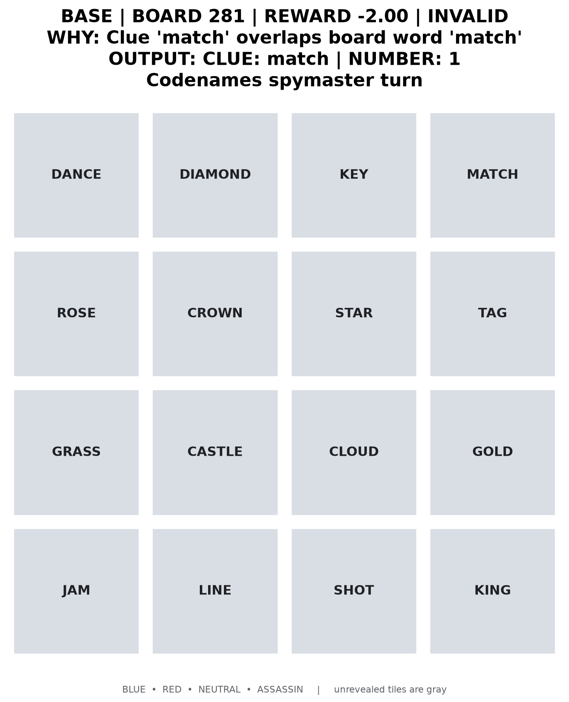
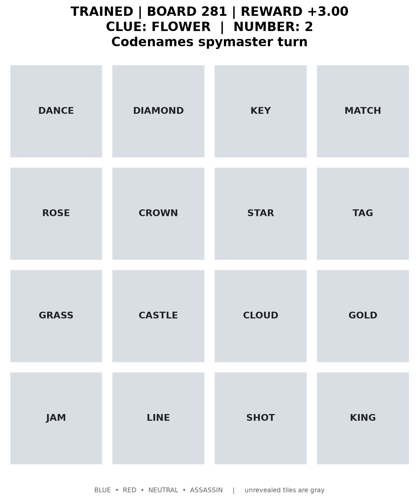

# Codenames Spymaster with GRPO

Reinforcement-learning fine-tuning of a small language model (Qwen2.5-0.5B-Instruct)
to play the **spymaster** in Codenames. The model sees the board and its hidden
team labels and must output one clue word and a number:

```text
CLUE: <single word>
NUMBER: <integer 1-4>
```

There is no labeled "correct" clue. The policy is trained with **Group Relative
Policy Optimization (GRPO)** and LoRA: a fixed sentence-embedding guesser turns each
clue into guesses, and a game simulator scores the turn.

| Base model: invalid clue (−2.0) | GRPO-trained: `FLOWER 2` → rose, grass, star (+3.0) |
| :---: | :---: |
|  |  |

## Results

Held-out evaluation on **1,000 boards** (seed `30000`, never used in training).
Both models see identical boards, so every board is a paired comparison.

| Model | Average reward | Invalid clues | BLUE guesses/turn |
| --- | ---: | ---: | ---: |
| Base Qwen2.5-0.5B-Instruct | −1.463 | 63.4% | 0.249 |
| GRPO + Unsloth + LoRA | **−0.681** | **8.7%** | **0.607** |

The paired reward delta is **+0.782**: the trained model wins 526 boards, ties 360,
and loses 114.

### Does it transfer?

Two stricter tests on the same 100 boards (seed `40000`), built only from words
that never appear in training (`data/evaluation_vocabulary_oov.txt`):

| Guesser at evaluation | Model | Average reward | Invalid clues | BLUE guesses/turn |
| --- | --- | ---: | ---: | ---: |
| Embedding guesser (training-time) | Base | −1.437 | 57% | 0.36 |
| | GRPO | **−0.825** | **8%** | **0.61** |
| Frozen LLM guesser (never seen in training) | Base | −1.387 | 57% | 0.26 |
| | GRPO | **−0.976** | **8%** | **0.49** |

The gain survives a guesser the policy was never optimized against, so the model
is not only exploiting quirks of the embedding model.

### What did not work (yet)

- **Clue diversity.** The trained policy's most common clue is `secret`
  (425/1,000 turns). Performance is stable but relies on a few safe, generic clues.
- **Scaling to Qwen2.5-1.5B.** The 1.5B base model is already much better
  (30.5% invalid clues vs 63.4% for 0.5B), but GRPO did not improve it: one run
  raised invalid clues to 50.5%, and a lower learning rate (1e-7) left it
  unchanged (35.0% → 36.5%). Evaluated on 200 boards.

## How it works

1. **Environment** (`codenames_env.py`): generates 16-word boards (6 BLUE, 6 RED,
   3 NEUTRAL, 1 ASSASSIN), validates clues, and simulates the guesser.
2. **Prompt**: explains the turn cycle, scoring, the `NUMBER + 1` guess allowance
   and clue rules. Board words are grouped by label because tile position carries
   no meaning; the label names themselves are rejected as clues so the model
   cannot earn reward by copying `BLUE`.
3. **Guesser**: ranks the remaining words by cosine similarity with
   `sentence-transformers/all-MiniLM-L6-v2`, makes up to `NUMBER + 1` guesses, and
   stops at the first non-BLUE word.
4. **Reward** (per turn):

   | Event | Reward | Reason |
   | --- | ---: | --- |
   | BLUE guessed | `+1.0` | Progress toward the spymaster's objective |
   | NEUTRAL guessed | `-0.3` | Turn ends, game continues |
   | RED guessed | `-1.0` | Helps the opposing team and ends the turn |
   | ASSASSIN guessed | `-5.0` | Ends the game, so this risk must dominate |
   | Invalid clue | `-2.0` | Discourages format and rule violations |

   Training adds a bounded semantic safety-margin bonus and a small within-board
   duplicate-clue penalty; evaluation always reports the unshaped game reward.
5. **Training** (`train_grpo.py`, `train_grpo_unsloth.py`): GRPO with LoRA on
   procedurally generated boards; the Unsloth path uses vLLM-backed rollouts.

**Why a language model?** The action is an open-ended word from a large
vocabulary whose value depends on its relation to several board words at once.
A fixed-output classifier does not represent that action space naturally; a small
language model gives a practical policy over it.

## Project structure

| Path | Purpose |
| --- | --- |
| `codenames_env.py` | Board generation, clue rules, embedding/LLM guessers, turn simulation, rewards |
| `train_grpo.py` | Procedural dataset, GRPO training, LoRA configuration |
| `train_grpo_unsloth.py` | Unsloth + vLLM accelerated GRPO training |
| `evaluate.py` | Paired base-vs-trained evaluation, CSV metrics, transcripts |
| `render.py`, `render_evaluation.py` | Board frames and animated GIFs of evaluated turns |
| `visualize_attention.py` | Attention heatmaps and occlusion analysis per board word |
| `scripts/build_training_vocabulary.py` | Reproducibly builds the 5,000-word training vocabulary |
| `data/` | Training vocabulary and the disjoint evaluation-only vocabulary |
| `tests/` | 27 fast unit tests (no model downloads), run in CI |

## Setup

Requires Python 3.11+. With [uv](https://docs.astral.sh/uv/):

```bash
uv sync                                          # exact versions from uv.lock
uv run python -m unittest discover -s tests -v   # fast checks, no model downloads
uv run python train_grpo.py --smoke-test
```

With pip: `pip install -r requirements.txt`.

The ML stack (PyTorch, model weights) is large and meant for a CUDA machine. The
default model fits an 8 GB laptop GPU with LoRA, batch size 1 and short completions.

### Optional Unsloth environment

Unsloth may need newer Torch/TRL/vLLM versions than the baseline, so it lives in a
separate environment:

```bash
uv venv .venv-unsloth --python 3.12
uv pip install --python .venv-unsloth/bin/python -r requirements-unsloth.txt
```

## Training

Run a one-step GPU check first, then the full experiment:

```bash
uv run python train_grpo.py --num-boards 8 --seed 123 --max-steps 1 \
  --save-steps 1 --output-dir outputs/smoke-model

uv run python train_grpo.py --num-boards 2000 --seed 10000 --max-steps 1000 \
  --save-steps 50 --learning-rate 5e-7 \
  --output-dir outputs/codenames-grpo-prompt-v3-lr5e-7
```

The adapter reported above was trained with the Unsloth path:

```bash
.venv-unsloth/bin/python train_grpo_unsloth.py --num-boards 2000 --seed 10000 \
  --max-steps 1000 --save-steps 50 --learning-rate 5e-7 \
  --fast-inference --no-flashinfer --output-dir outputs/codenames-unsloth-prompt-v3
```

- Add `--resume` to continue from the highest-numbered `checkpoint-*` directory.
  Resuming requires the same prompt, dataset seed and main settings.
- On CUDA out-of-memory, shrink the rollout group first: `--num-generations 4
  --max-prompt-length 384 --max-completion-length 32`.
- BF16 is selected automatically when supported. The embedding guesser runs on CPU
  to leave GPU memory for rollouts, and sentence embeddings are cached per board
  and clue.
- `--no-flashinfer` is applied automatically when `nvcc` is unavailable.

### Expanded vocabulary

`data/training_vocabulary.txt` holds 5,000 frequency-ranked English words from
[`wordfreq`](https://github.com/rspeer/wordfreq) (CC BY-SA 4.0), filtered for
function words and kept disjoint from the evaluation vocabulary. Both trainers
accept `--vocabulary-file data/training_vocabulary.txt`. Regenerate it with:

```bash
uv run --with wordfreq python scripts/build_training_vocabulary.py
```

## Evaluation

```bash
uv run python evaluate.py \
  --adapter-dir outputs/codenames-unsloth-prompt-v3 \
  --num-boards 1000 --seed 30000 \
  --output-csv results/evaluation-unsloth-1000.csv \
  --transcript-file results/transcripts-unsloth-1000.txt
```

- Out-of-vocabulary boards: add `--vocabulary-file data/evaluation_vocabulary_oov.txt`.
  These words are disjoint from training, although tokenizers still split them into
  familiar subwords.
- Frozen LLM teammate: add `--guesser llm --llm-guesser-device cuda`. The LLM sees
  only the clue and the 16 words, never the labels.

Each board produces two CSV rows (`model=base` and `model=trained`) with the
completion, parsed clue and number, ordered guesses and their labels, reward,
invalid reason, and the full board. Compare rows sharing a `board_index`.

Render random evaluated turns as GIFs (plus an answer-key PNG):

```bash
uv run python render_evaluation.py --evaluation-file results/evaluation-unsloth-1000.csv \
  --count 5 --model both --seed 7 --show-labels --output-dir results/evaluation-renders
```

## Attention and occlusion analysis

`visualize_attention.py` reloads an evaluated turn with eager attention and draws a
Codenames-style heatmap of how much attention each board word receives, the most
board-focused layer/head, and a JSON trace. `--occlusion` removes each board word in
turn and measures the change in the clue's log-probability, a more causal companion
to raw attention. It needs the regular Transformers environment, because
Unsloth/vLLM inference does not expose attention tensors.

```bash
uv run python visualize_attention.py \
  --evaluation-file results/evaluation-unsloth-oov-100.csv \
  --adapter-dir outputs/codenames-unsloth-prompt-v3 \
  --model trained --count 5 --seed 7 --occlusion --output-dir results/attention-oov
```

## Limitations

- Episodes are single turns, not complete multi-turn games.
- The reported adapter was trained on the 88-word default vocabulary. The
  5,000-word vocabulary is included but not yet used for a reported run.
- The embedding guesser approximates human word association and is not trained
  jointly with the spymaster. Self-play between two language models would be more
  realistic but slower and harder to stabilize.
- Changing the prompt or clue rules changes the task: retrain before comparing
  adapters across prompt versions.
- The code targets the TRL 0.14 GRPO interface and filters configuration
  arguments against the installed version.

## License

MIT. See [LICENSE](LICENSE).
